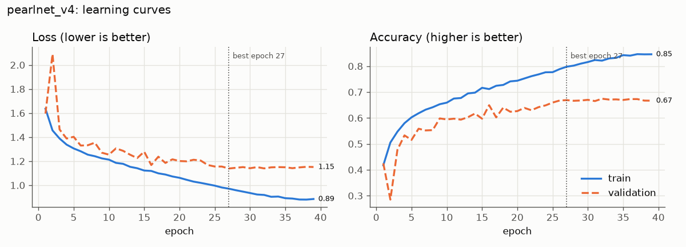
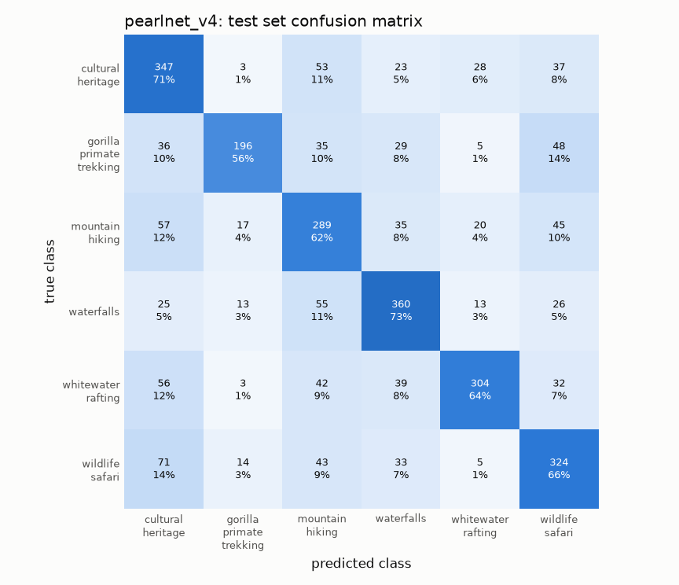

# PearlRoute Vision

An image classifier that recognises the kind of East African tourism experience shown in a photo,
and suggests destinations for it. It is module one of the PearlRoute AI capstone.

The model is **PearlNet**, a CNN I trained from scratch (no pretrained weights). It sorts a photo into one of six classes:

| Class | What the photo shows |
|---|---|
| `gorilla_primate_trekking` | a gorilla, chimpanzee or monkey, usually in forest |
| `wildlife_safari` | large savannah animals (elephant, lion, giraffe, zebra, ...) or a game-drive vehicle |
| `whitewater_rafting` | a raft or kayak on rough water (even at a waterfall) |
| `waterfalls` | water falling over raised rock |
| `mountain_hiking` | mountain scenery, peaks or trails, often with hikers |
| `cultural_heritage` | traditional dance, drumming, crafts, cultural dress, heritage sites and monuments |

The project covers the whole ML pipeline: collecting and cleaning the data, training and evaluating two models,
an API that serves the model, a Streamlit app, and retraining on new photos that users upload.

| | |
|---|---|
| **Video demo** | YouTube: _add link_ |
| **Live app** | https://pearlroute-vision.purplewave-80e66de8.southafricanorth.azurecontainerapps.io |
| **Notebook** | [`notebook/pearlroute_vision.ipynb`](notebook/pearlroute_vision.ipynb): preprocessing (sections 2-12), model training (13-26), prediction functions (27) |
| **Model file** | [`models/pearlnet_v4/pearlnet_v4.h5`](models/pearlnet_v4/pearlnet_v4.h5) (Keras .h5; the app loads the same model from `model.keras`) |
| **Load test results** | [Load test (Locust)](#load-test-locust) below; raw stats in [`reports/locust/`](reports/locust/) |
| **Setup** | [Setup](#setup) and [Docker](#docker) below |

## Results

Both models were trained on the same split with the same settings: AdamW, a cosine learning rate,
label smoothing and MixUp/CutMix augmentation. Both were scored on the same 2,761 test photos,
which were never used for training or for choosing the best epoch.

| Model | Parameters | Test accuracy | Macro F1 | Macro precision | Macro recall | ROC-AUC | Training time (CPU) |
|---|---|---|---|---|---|---|---|
| Baseline CNN | 1.88 M | 62.6% | 0.625 | 0.639 | 0.621 | 0.883 | 1.5 h |
| **PearlNet v4 (served)** | 2.67 M | **65.9%** | **0.660** | **0.680** | **0.654** | **0.896** | 5.3 h |

There are six classes, so guessing would score about 17%.
I chose PearlNet v4 by **validation** macro F1 (0.674 vs 0.630), not by test score, so the test score stays a fair check.

F1 per class on the test set:

| Class | Baseline | PearlNet v4 |
|---|---|---|
| cultural_heritage | 0.62 | 0.64 |
| gorilla_primate_trekking | 0.61 | 0.66 |
| mountain_hiking | 0.55 | 0.59 |
| waterfalls | 0.64 | 0.71 |
| whitewater_rafting | 0.71 | 0.71 |
| wildlife_safari | 0.62 | 0.65 |

PearlNet v4 is better than or equal to the baseline on every class.
The hardest class is mountain_hiking, which the model most often mistakes for cultural heritage or wildlife safari.
Gorilla photos have high precision (0.80) but low recall (0.56): when the model says gorilla it is usually right, but it misses many.

**How PearlNet improved.** The first PearlNet on this dataset used plain Adam with an L2 penalty and reached 63.4%.
v4 keeps the same network and only changes the training settings (AdamW, cosine learning rate, MixUp/CutMix).
That raised test accuracy to 65.9% and reduced overfitting: the gap between train and validation accuracy fell from 0.15 to 0.13.




**Known limits.** There is no "none of these" class, so a photo of something else (a selfie, a city street)
still gets one of the six labels. When the top answer is below 40% confidence, the app flags it as uncertain.
Some photos honestly fit two classes, such as rafting below a waterfall or a hike up to a waterfall.

The full walk-through, with charts and explanations, is in [`notebook/pearlroute_vision.ipynb`](notebook/pearlroute_vision.ipynb).

## The dataset

- **Sources:** openly licensed photos from Wikimedia Commons (17,987) and Openverse (1,659), searched by class and by
  East African destination (Uganda, Rwanda, Kenya, Tanzania and neighbours). Licences: CC BY-SA, CC BY, CC0 and public domain.
  The creator, licence and source page of every image are in [`data/metadata.csv`](data/metadata.csv).
- **Labelling:** ordered label rules in [`configs/data.yaml`](configs/data.yaml) check each photo's title, tags and categories
  before download, which moves or drops photos that would be mislabelled.
- **Cleaning:** 19,646 downloaded → 18,484 kept. I reviewed the photos by eye on a contact sheet and removed 1,154
  ([`data/exclude.txt`](data/exclude.txt)), most of them gorilla photos that weren't really gorillas.
  Near-duplicates and grayscale images were also dropped.
- **Split:** 70 / 15 / 15 train / val / test, with each photographer in only one split, so similar shots from one person can't leak
  from train into test. Train has 1,617–2,288 photos per class, and val and test have about 350–490 each.
  A small sample is held out for retraining demos ([`data/retrain_sample.zip`](data/retrain_sample.zip)).
- **Input:** photos are resized to 160 × 160 and normalised with the training set's channel mean and std ([`data/stats.json`](data/stats.json)).
  Each model saves the stats it was trained with in its `metadata.json`, and the API and retraining use those.

The images themselves are not in git (about 5 GB). The scripts below download and rebuild them.

## The models

- **Baseline:** a plain CNN with 4 blocks of convolution + max-pooling, then Flatten → Dense(128) → Dropout → softmax.
- **PearlNet:** a convolutional stem, then four stages of residual blocks with batch norm and squeeze-excitation,
  then global average pooling → dropout → softmax. Global pooling replaces the baseline's large Flatten + Dense layer.

The architectures are set in [`configs/model.yaml`](configs/model.yaml), and the training settings in [`configs/train.yaml`](configs/train.yaml).

## Project layout

```
app/                  Streamlit UI (Predict, Data insights, Upload & retrain, Model status)
configs/              data.yaml (classes, sources, label rules, split), model.yaml, train.yaml
data/                 metadata, counts, stats, exclude list, retrain sample (images are git-ignored)
models/<name>/        model.keras, metadata.json, metrics.json, history.csv per trained model (+ pearlnet_v4.h5)
notebook/             pearlroute_vision.ipynb: the full analysis
reports/figures/      learning curves and confusion matrices
scripts/              command-line entry points (collect, clean, split, train, predict, init_db)
src/pearlroute/       the package: data, preprocessing, models, training, evaluation, inference, api, db, retraining
tests/                pytest suite
```

## Setup

You need Python 3.11.

```bash
python -m venv .venv
.venv\Scripts\activate          # Windows;  source .venv/bin/activate on macOS/Linux
pip install -r requirements.txt
pip install -e .
```

Copy `.env.example` to `.env` and fill it in:

| Variable | Needed for |
|---|---|
| `DATABASE_URL` | upload, retraining and model versions (PostgreSQL, e.g. a Supabase session pooler URL starting with `postgresql+psycopg2://`) |
| `OPENVERSE_CLIENT_ID`, `OPENVERSE_CLIENT_SECRET` | collecting images from Openverse (optional, raises the rate limit) |

Then create the tables and register the trained models:

```bash
python scripts/init_db.py
```

Prediction works without a database. Only upload and retraining need one.

## Running it

**API** (FastAPI). Interactive docs are at http://127.0.0.1:8000/docs:

```bash
uvicorn pearlroute.api.main:app --reload
```

| Method | Path | What it does |
|---|---|---|
| GET | `/health` | Is the API up, and is a model loaded? |
| GET | `/model` | The model being served and its scores |
| POST | `/predict` | Classify one photo |
| POST | `/predict/batch` | Classify up to 20 photos |
| POST | `/upload` | Add labelled photos for retraining (photos, or zips with one folder per class) |
| GET | `/upload/stats` | Uploaded photos per class, used vs waiting |
| POST | `/retrain` | Fine-tune the active model on the uploaded photos (runs in the background) |
| GET | `/retrain/latest`, `/retrain/{job_id}` | Progress and result of a retraining job |
| GET | `/retrain/versions` | Every model version, newest first |

**Streamlit app**. Start it while the API is running. It finds the API through `PEARLROUTE_API_URL` (default `http://127.0.0.1:8000`):

```bash
streamlit run app/streamlit_app.py
```

**Command line:**

```bash
python scripts/predict.py my_photo.jpg            # top 3 classes and destinations
python scripts/predict.py photo.jpg --json
```

## Retraining

Users upload labelled photos through the app or `POST /upload`, and they are stored in the database.
`POST /retrain` then runs seven steps in the background:

1. **check new data:** needs at least 10 new photos
2. **export new data:** writes the uploads to a run folder
3. **load parent model:** the model currently being served
4. **build datasets:** the new photos plus 300 original training photos per class (`retrain.original_per_class`), so the model
   keeps the old classes in mind (rehearsal); the photos are resized and normalised exactly as in training
5. **fine-tune:** up to 8 epochs at a 10× lower learning rate, so the model adapts without forgetting
6. **evaluate and compare:** scores on the same validation set as the parent
7. **save and register:** saves `models/pearlnet_v4_r1/` (then `_r2`, ...), records it in the database, and makes it the served model
   if its validation macro F1 is no more than 0.01 below the parent's

You can try it with the photos in `data/retrain_sample.zip`.

## Rebuilding the data and models from scratch

```bash
python scripts/collect_images.py                  # download (safe to stop and re-run); --include-fallback for more
python scripts/apply_label_rules.py --fetch-keywords   # report label-rule changes; add --apply to make them
python scripts/clean_images.py                    # drop corrupt, small, grayscale, duplicate and excluded images
python scripts/split_dataset.py                   # photographer-safe train/val/test split
python scripts/train.py --model baseline          # about 1.5 h on a CPU
python scripts/train.py --model pearlnet --run-name pearlnet_v4   # about 5 h on a CPU
```

`scripts/contact_sheet.py` builds an HTML page for reviewing photos by eye. Clicking a photo marks it for `data/exclude.txt`.
The served model is set by `serving.active_model` in `configs/model.yaml`.

## Tests

```bash
pytest
```

109 tests cover data sources, cleaning and splitting, loaders, preprocessing, models, the predictor, the API, the database and retraining.
They use SQLite, so they don't need the real database.

## Docker

One image runs both the API (port 8000) and the Streamlit app (port 8501). The trained models are built into it.

```bash
docker compose up --build
```

Then open http://localhost:8501 for the app and http://localhost:8000/docs for the API.

- **Database:** the container reads `DATABASE_URL` from `.env`, creates the tables and registers the models at startup.
  To use a local Postgres instead of Supabase, set
  `DATABASE_URL=postgresql+psycopg2://pearlroute:pearlroute@db:5432/pearlroute` in `.env` and run
  `docker compose --profile localdb up --build`. Without a database, prediction still works.
- **Volumes:** `./data/processed` is mounted read-only, because retraining fine-tunes on the original training photos as well.
  `./data/demo` provides the Predict page's demo photos. Retrained models are kept in the `models` volume, so they survive restarts.
- **Without compose:** `docker build -t pearlroute-vision .` then
  `docker run -p 8000:8000 -p 8501:8501 --env-file .env pearlroute-vision`. This is enough for prediction.
  Retraining needs the mounts above.
- **Memory:** the container uses about 2 GB while retraining (Docker Desktop's default 4 GB is enough). Retraining on CPU takes
  over 10 minutes per epoch on all 12,800 original photos; with the default 300 per class, a retrain takes about 8 minutes.
- **After a rebuild,** run `docker compose up -d --build --force-recreate` so the running container picks up the new image.
  The `models` volume keeps the models from the first start; `docker compose down -v` resets it to the image's models.

## Live deployment

The app runs on Azure Container Apps: **https://pearlroute-vision.purplewave-80e66de8.southafricanorth.azurecontainerapps.io**

It is the same Docker image (plus the demo photos), stored in Azure Container Registry, with 2 vCPU and 4 GB RAM, one replica always on,
and `DATABASE_URL` stored as a secret. Prediction and upload work there. Retraining needs the original training photos, which are not
in the cloud image, so it runs on the local Docker setup.

## Load test (Locust)

`load_test/locustfile.py` simulates travellers sending photos: 10 single predictions for every 2 batches of 5 and 1 health check,
with 1-3 s between requests per user. `pip install -r requirements-dev.txt`, then `bash load_test/run.sh [host]` runs 10, 50 and 100 users for 90 s each and writes CSV
stats and HTML reports to `reports/locust/`.

Results against one container on a laptop (CPU only, 16 cores, 4 GB for Docker):

| Users | Requests/s | Median | 95th percentile | Failures |
|------:|-----------:|-------:|----------------:|---------:|
| 10    | 4.6        | 62 ms  | 320 ms          | 0        |
| 50    | 19.8       | 300 ms | 2.0 s           | 0        |
| 100   | 17.5       | 2.5 s  | 11 s            | 1 of 1,553 |

One container tops out at about 20 requests/s. Beyond that, extra users queue and response times grow. Before inference was
compiled with `tf.function`, the same container managed only 2.5 requests/s, with a 20 s median at 50 users
(`reports/locust_before/`).
